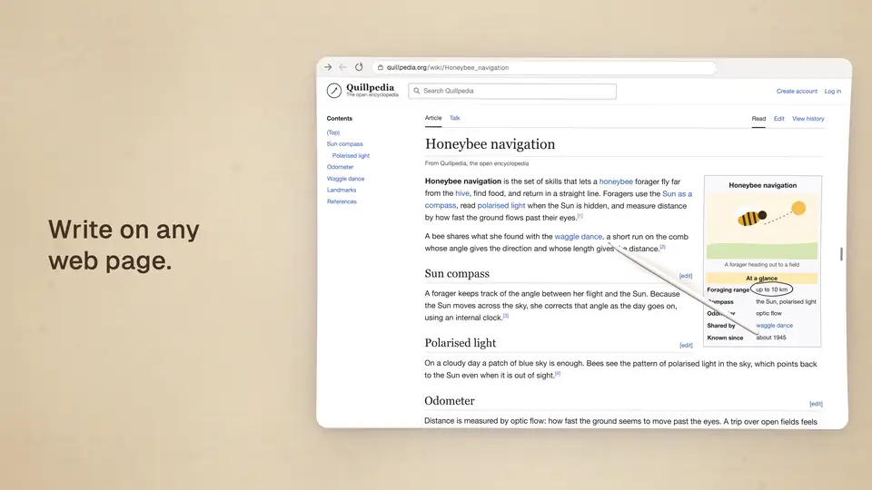
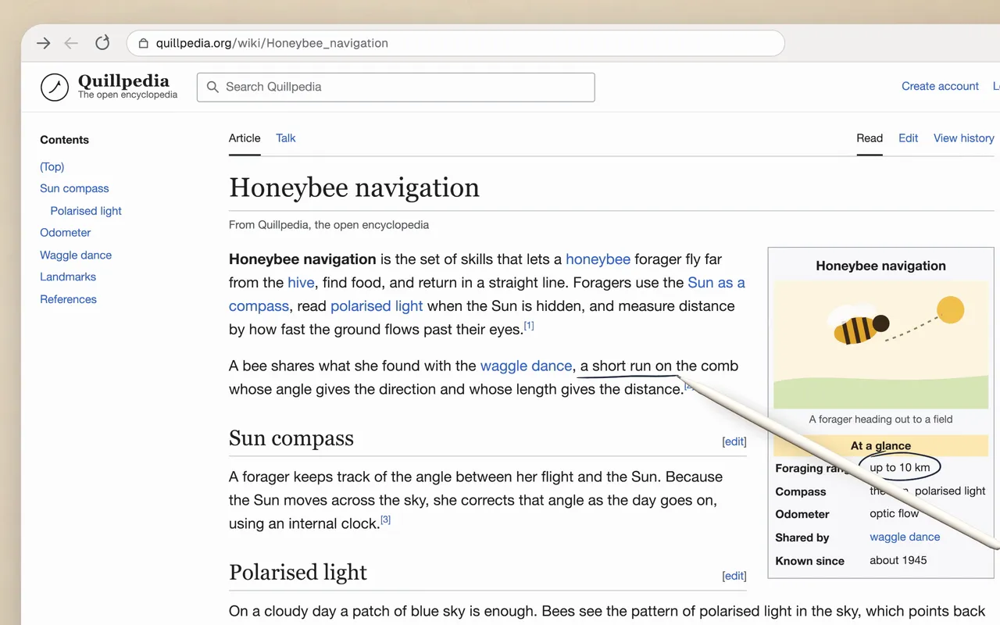
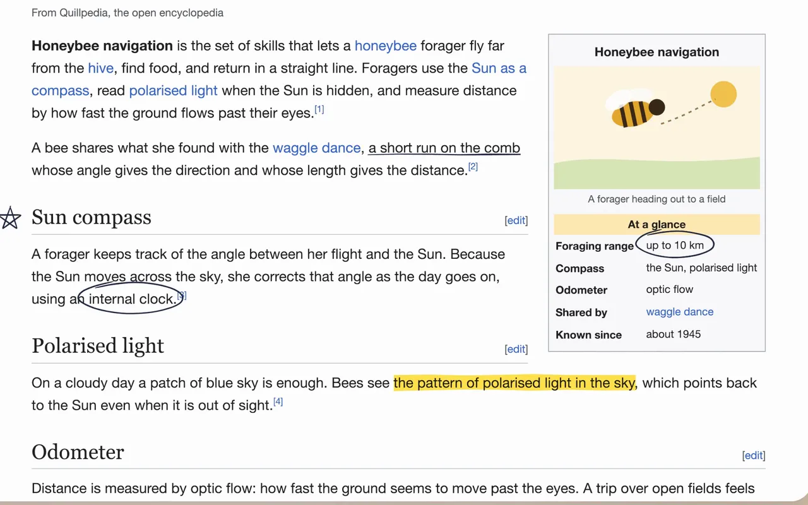
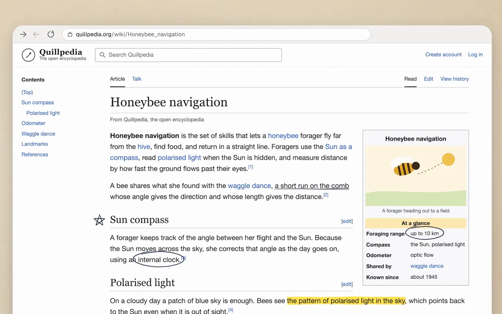

# <picture><source media="(prefers-color-scheme: dark)" srcset="brand/pageink-logo-dark.svg"></picture>

PageInk is a free, open source browser extension for handwriting on web pages.
Write, draw and highlight on any page with Apple Pencil, a finger or a mouse.
Your ink loads with the page, stays for good, and stays on the same words when the page changes or reflows.
It is also a library any site can add to its own pages.

Get PageInk from the [Chrome Web Store](https://chromewebstore.google.com/detail/pageink/okegfngejejaddeaobgpamojcdddlmgf),
from [Microsoft Edge Add-ons](https://microsoftedge.microsoft.com/addons/detail/pageink/nocfjhikfelnnjakadlpchhppdihamdo),
or from the [App Store](https://apps.apple.com/app/id6837846057) for Safari on iPad.
The Firefox add-on and the Safari app for Mac are in review. [Install from source](#install-from-source)
shows how to build it and load it into Chrome, Edge, Firefox or Safari.

Website: https://parag0506.github.io/pageink/

PageInk is free and open source under the MIT licence. There is no account with us and no server of ours. Apart from
reading an open PDF once more for its viewer, the extension talks to nobody unless you connect your own
cloud, and then only to that cloud. [PRIVACY.md](PRIVACY.md) lists each privacy fact and the test or
check behind it.



[Watch the one-minute film](https://www.youtube.com/watch?v=7c85j0Y0f2Q) of it in use.

<p>
  
  
  
</p>

## Four promises

Each promise has a mechanism and, where one exists, a measured number. The table at the end of this
section has the numbers, read from the latest runs. [docs/DESIGN.md](docs/DESIGN.md) section 5 has the details.

### 1. The page loads as fast as it normally does

A stub of under 3 KB (3,051 bytes minified, 3,066 in Safari) is the only code injected on every page.
It makes one read from extension storage and listens for pointer events on the window, so it can wake
when you start to write with a pen. It does not touch the page. On a site where you have written, the
background registers the viewer as a content script for that site, so it is already in the page when
the page starts to load. Everywhere else the viewer and the drawing tools are put into the page only
when a pen touches down or you switch on drawing. Nothing is loaded by address, and the same code runs
in every browser, Safari included. A test fails the build if the stub grows past 3 KB. The bench
publishes what the stub costs on pages without ink, what its pointer listeners cost while you move the
mouse, and how long the first stroke takes while the tools load.

### 2. Ink appears with the page

Each stroke is stored with its finished outline, so showing it is one SVG insert with nothing to compute.
On a site with ink, a small boot script starts reading the page's record from storage at the very
start of the load, beside the stub's read and before the viewer is compiled. Notes are placed while the page loads, right after the
browser's own layout of their content, so their ink can be painted in the same frame as that content.
The first placement looks only at each note's own block, not at the text of the whole page. A margin
note whose spot is taken docks into free space beside its text. One overlay scrolls with the page, so
no script runs while you scroll. The budget: ink within 50 ms of its anchor content existing, and on
screen in the same frame as that content's first paint, or at most one frame later. Ink cannot be on
screen before the page's own first layout of its content, so where the page alone takes longer than
50 ms to paint it, the first number cannot be met; the table says where, with the page-alone time beside
it. The viewer starts and places the notes of the first screen before that first paint, which holds the
paint back. The budget for that is one frame; the table has the numbers.

### 3. Ink is permanent

Ink lives in the extension's own storage, so clearing a site's data does not clear it. You can keep a copy
in your own Google Drive or OneDrive, or in a folder you own, such as one that iCloud Drive or Dropbox syncs. Every stroke has an id
and deletions are recorded, so two devices can write offline and merge without losing anything. There is
no measured number for this promise. The merge rules are tested in `packages/core/src/store/`.

### 4. Ink stays in place when the page changes

Strokes written together form a note, anchored to the words, block or picture under it, with several
independent ways to find it again. When the page changes, a ladder of methods finds each anchor, ending in
an approximate text match with a similarity bar. A note whose passage is gone waits in a "Moved notes" tray
on that page with its original words. A public test set measures how many notes land in the right place.
[docs/ANCHORING.md](docs/ANCHORING.md) describes the method.

### Measured

<!-- results:readme:start -->
| promise | measure                                                                                | result                                                                                                                                                                                                                                                                                                                                                                                                                   | target                                                                                                                                                                                            | status   |
| ------- | -------------------------------------------------------------------------------------- | ------------------------------------------------------------------------------------------------------------------------------------------------------------------------------------------------------------------------------------------------------------------------------------------------------------------------------------------------------------------------------------------------------------------------ | ------------------------------------------------------------------------------------------------------------------------------------------------------------------------------------------------- | -------- |
| 1       | Extension time on the page's main thread, page with no ink                             | worst page median 4.27 ms (arxiv-html); highest single load 10.47 ms; stub self-timing worst median 1.25 ms                                                                                                                                                                                                                                                                                                              | under 5 ms                                                                                                                                                                                        | pass     |
| 1       | First and largest paint, page with no ink                                              | no difference beyond noise that repeats, on all 20 pages                                                                                                                                                                                                                                                                                                                                                                 | no change beyond noise                                                                                                                                                                            | pass     |
| 1       | First paint of content under ink, held back by the extension                           | cold / warm: seed-lesson 9.5 ms (noise 10.4 ms) / 16.1 ms (noise 10.7 ms); seed-article 14.8 ms (noise 1.6 ms) / 10.8 ms (noise 10.8 ms); seed-lazy 13.6 ms (noise 7.1 ms) / 11.3 ms (noise 5.2 ms). Stress page, reported: cold 6.5 ms (noise 3.7 ms), loads without / with the extension 5 at 129.5 ms / 5 at 137.2 ms; warm 24.2 ms (noise 12.8 ms), loads without / with the extension 8 at 115.3 ms / 8 at 138.6 ms | at most 16.7 ms (one frame) on every seeded page, cold and warm                                                                                                                                   | pass     |
| 2       | Ink visible within 50 ms of its anchor content existing, cold browser                  | not met on stress-wikipedia 60.5 ms, the page first painted that content 60.9 ms after inserting it with the extension and 58.5 ms without it. Met on 3 of 4 seeded pages                                                                                                                                                                                                                                                | within 50 ms                                                                                                                                                                                      | fail     |
| 2       | Ink visible within 50 ms of its anchor content existing, warm browser                  | not met on stress-wikipedia 57.5 ms, the page first painted that content 57.8 ms after inserting it with the extension and 50.9 ms without it. Met on 3 of 4 seeded pages                                                                                                                                                                                                                                                | within 50 ms                                                                                                                                                                                      | fail     |
| 2       | Ink on screen with its content's first paint, cold browser                             | same frame in 20 of 20 loads; more than one frame late in 0 (none); worst 0.0 ms (seed-lesson). Medians per page: all within one frame                                                                                                                                                                                                                                                                                   | same frame, or within one frame (16.7 ms), every load                                                                                                                                             | pass     |
| 2       | Ink on screen with its content's first paint, warm browser                             | same frame in 32 of 32 loads; more than one frame late in 0 (none); worst 0.0 ms (seed-lesson). Medians per page: all within one frame                                                                                                                                                                                                                                                                                   | same frame, or within one frame (16.7 ms), every load                                                                                                                                             | pass     |
| 2       | Ink script during a scripted scroll                                                    | 0 events                                                                                                                                                                                                                                                                                                                                                                                                                 | none                                                                                                                                                                                              | pass     |
| 2       | Long tasks caused by ink, 200 notes                                                    | 0 caused by ink; loads with a task over 50 ms: cold 2 of 20 with the extension, 14 of 20 alone, 11 of 20 with a do-nothing extension; warm 4 of 20 with the extension, 4 of 20 alone, 5 of 20 with a do-nothing extension. Longest task that ran ink script 40.0 ms, 3.6 ms of it ink; 0 such tasks over 50 ms. Longest page task with / without the extension: cold 44.0 ms / 73.1 ms, warm 52.1 ms / 70.3 ms           | no task over 50 ms that would be within it without its ink part, or with over 50 ms of ink; loads with a long task no more often than with a do-nothing extension, beyond chance, in two measures | pass     |
| 2       | Ink's part of any one task, 200 notes                                                  | at most 9.4 ms, over 6 loads cold and warm                                                                                                                                                                                                                                                                                                                                                                               | at most one frame (16.7 ms), every load                                                                                                                                                           | pass     |
| 1       | Pointer listeners: extension script while the mouse moves and the page scrolls, no ink | lesson: 7.51 ms for 400 pointer moves and 20 scrolls; wikipedia: 6.76 ms for 400 pointer moves and 20 scrolls                                                                                                                                                                                                                                                                                                            | no budget, published                                                                                                                                                                              | measured |
| 1       | Pen-down to first pixel, first stroke on a page with no ink, background stopped        | median 16.0 ms (IQR 1.9 ms, max 21.3 ms, 10 loads)                                                                                                                                                                                                                                                                                                                                                                       | no budget, published                                                                                                                                                                              | measured |
| 1       | Pen-down to first pixel, first stroke on a page with no ink, background running        | median 29.1 ms (IQR 4.2 ms, max 39.9 ms, 10 loads)                                                                                                                                                                                                                                                                                                                                                                       | no budget, published                                                                                                                                                                              | measured |
| 1       | Pen-down to first pixel, later strokes                                                 | median 0.9 ms (IQR 1.0 ms, max 1.7 ms, 20 loads)                                                                                                                                                                                                                                                                                                                                                                         | no budget, published                                                                                                                                                                              | measured |
| 4       | Notes in the right place after the page changed (document pages)                       | 99.4%                                                                                                                                                                                                                                                                                                                                                                                                                    | 95.0% or better                                                                                                                                                                                   | pass     |
| 4       | Notes in the wrong place (document pages)                                              | 0.3%                                                                                                                                                                                                                                                                                                                                                                                                                     | under 2.0%                                                                                                                                                                                        | pass     |
| 4       | Notes accounted for (placed or in the tray)                                            | 100.0%                                                                                                                                                                                                                                                                                                                                                                                                                   | 100.0%                                                                                                                                                                                            | pass     |

Bench: `bench/results/latest.json`, extension `bench/cache/ext-real` (PageInk 0.1.1), a copy of the Chrome bench build: the release code plus the performance marks the bench reads, run of 2026-11-22. Test set: `testset/results/latest.json`, anchor module `packages/core/src/anchor/index.ts`, run of 2026-11-22. Details in [docs/RESULTS.md](docs/RESULTS.md).

Ink visible over 50 ms on stress-wikipedia (200 notes): 60.5 ms cold and 57.5 ms warm after its anchor content was inserted. With the extension the page first painted that content 60.9 ms (cold) and 57.8 ms (warm) after inserting it; without the extension, 58.5 ms (cold) and 50.9 ms (warm). Counted from that first paint, the ink came in the same frame (cold) and in the same frame (warm). [docs/RESULTS.md](docs/RESULTS.md) has the timeline.
<!-- results:readme:end -->

## Install from source

Build the extension, then load it into your browser.

```
corepack enable
corepack pnpm install
corepack pnpm --filter pageink-extension build:all
```

You need Node.js 22.12 or later on the 22 line, Node 24, or Node 26 or later. CI uses Node 24. The builds
are written to `packages/extension/.output/`.

A build from source has no cloud client ids, so the Google Drive and OneDrive buttons say "Not set up in
this build". The folder and the archive work. To use a cloud, make your own client ids as in
[docs/CLOUD_SETUP.md](docs/CLOUD_SETUP.md).

### Chrome and Edge

1. Open `chrome://extensions` (Chrome) or `edge://extensions` (Edge).
2. Turn on **Developer mode**.
3. Click **Load unpacked** and choose `packages/extension/.output/chrome-mv3` (Chrome) or
   `packages/extension/.output/edge-mv3` (Edge).

Chrome and Edge 119 or later are needed.

### Firefox

1. Open `about:debugging#/runtime/this-firefox`.
2. Click **Load Temporary Add-on** and choose `packages/extension/.output/firefox-mv3/manifest.json`.

A temporary add-on is removed when Firefox quits. Firefox 140 or later is needed, and 142 or later on
Android.

### Safari on Mac and iPad

Safari needs the extension inside an app. [apple/README.md](apple/README.md) explains how to build the app
in Xcode and run it on a Mac or install it on an iPad over a cable with free signing. Safari 17 or later
is needed: macOS 14 or later on a Mac, iPadOS 17 or later on an iPad.

Safari loads the extension the same way as Chrome, Edge and Firefox. Every page gets only a stub of
about 3 KB. The code that shows ink is added at the start of the page only on sites where you have ink,
and the drawing tools are added when the Pencil first touches a page or you switch drawing on. Until
the tools are in, the stub holds the Pencil's touches back, so the first stroke writes instead of
scrolling the page.

In the app, **Sync** connects Google Drive, OneDrive or a folder (iCloud Drive works), and Safari then
reaches the same files as Chrome, Edge and Firefox. Safari cannot open a sign-in window for an
extension, so the app signs in with the system's own window and keeps the sign-in in the keychain.
Choosing a cloud in Safari's settings for the extension opens the app to finish. The app talks to
nobody until you connect a cloud, and then only to that provider.

## How to use it

- **Pen.** On a device with a pen (Apple Pencil, Windows and Android pens), touch the page and write.
  No switch is needed. A finger still scrolls and taps links.
- **Draw toggle.** With a mouse, a trackpad or a finger, turn on **Draw** first: from the toolbar button,
  from the bar on the page, or with **Alt+Shift+D**. While it is on, the mouse or one finger draws and two
  fingers scroll. Press **Esc** to stop. You can also draw with the mouse while you hold **Alt**.
- **Tools.** The bar on the page has two pen colours (**P**), a highlighter (**H**), an eraser (**E**), a
  lasso to move, split or join notes (**L**), and undo and redo (**Ctrl+Z**, **Ctrl+Shift+Z**). The
  letter keys work while Draw is on. The bar hides after a few seconds and comes back when you write.
- **Highlights and underlines.** A straight highlighter or pen line over text becomes a text mark. It is
  redrawn on those words at any width.
- **Moved notes tray.** If a note loses its words, the tray button on the bar shows a count. Open the
  tray to see the note and its saved words, choose **Place**, then tap where it belongs.
- **Export.** The **More** menu on the bar saves the page with its ink as an image, saves the notes as
  Markdown, copies them for a chat, or prints the page with its ink. The Library in the extension's
  settings lists every page you wrote on and exports an archive of everything.
- **Your own cloud or folder, and sync.** In the extension's settings, choose Google Drive, OneDrive or a
  folder on this device: one click, then the provider's own sign-in. Each page becomes one small JSON file
  there. Connect the same place on another device and the notes meet there. An optional password lock
  scrambles the files before they leave the device. Firefox on a computer offers the two clouds and the
  archive; Firefox for Android offers the archive. On Safari, the app connects the place.
  [docs/CLOUD_SETUP.md](docs/CLOUD_SETUP.md) has the one-time setup of the client ids.
- **Backup reminder.** Notes live in the browser's storage for the extension, which goes away if the
  extension is removed. Once you have ink on a few pages and no place to keep a copy, the toolbar button
  shows a dot and the popup asks once, quietly, to set one up. On Firefox it suggests exporting an archive
  instead, at most once a month.
- **Draw mode is remembered per site.** Turn on **Draw** at a site and it is on again the next time you
  open a page there, with a short note on how to stop. You can turn this off in the settings. Another
  setting makes the pen wait for **Draw** too, so it scrolls like a finger until you turn Draw on.
- **Clear page is permanent.** The **More** menu removes all ink on the page for good, after you
  confirm. It cannot be undone, and synced copies on other devices lose that ink too.
- **Dialogs and popovers.** Ink written on a modal dialog or an open popover is drawn above it.
- **Translated pages.** While the browser shows a translation, notes whose words changed wait in the
  tray under their own heading and come back when you show the original.
- **Private windows.** You can write, but nothing written in a private window is saved unless you allow
  it, and the bar says so. The setting "Keep ink written in private windows" allows it.
- **Turn it off for a site** from the toolbar button or the **More** menu. Your notes are kept.
- **PDFs.** A PDF opens in the extension's bundled viewer, where you write on it like any page. Ink is
  anchored to the PDF page and stays in place at any zoom, highlights become text marks on the PDF's
  words, and printing prints the PDF with its ink. In Chrome and Edge, a PDF address opens in the viewer
  by itself, and a setting keeps PDFs in the browser's own viewer with a button to switch. On Firefox and
  Safari, choose **Open a PDF** in the extension's settings and pick the file there. Local files work
  the same way: pick the file, and the notes come back when you open the same file again, under any name.

## Privacy

Apart from reading an open PDF once more for its viewer (below), the extension talks to nobody unless you
connect a cloud. Then it talks only to that provider, and only to its sign-in and file addresses. Your
notes stay in the browser's extension storage and in the one place you choose, if you choose one. There
is no account, no server of ours and no analytics. You can check this. The manifest asks for:

- `storage` and `unlimitedStorage`, to keep your notes on this device;
- access to all sites, so your ink comes back by itself when you return to a page;
- `scripting`, so the drawing code goes only into pages that have your ink or where you start to write,
  and no web page can find the extension by its files;
- `identity`, for the provider's sign-in window, asked for only when you click a cloud (Firefox lists it
  up front because it cannot be asked for later; it shows no warning);
- `nativeMessaging` on Safari only, to reach the app on the same device.

The content security policy lets extension pages connect only to the cloud providers' addresses, and to
nothing on Safari. A test fails the build if any network call or remote address appears outside the one
cloud file and the PDF read. The PDF read goes once more to the PDF address you opened, to hand the bytes
to the extension's own viewer ([docs/CONTRACT.md](docs/CONTRACT.md) section 6).
[PRIVACY.md](PRIVACY.md) lists the facts and how to check each one.

## The library and the embed script

`packages/core` is the library: capture, anchoring, placement, rendering and storage, with no
browser extension APIs. `packages/embed` builds it into one script that a site adds to its own pages.

```html
<script src="pageink.js" data-ink></script>
```

That is all. Readers write with a pen, or with a finger or mouse once the draw toggle is on. Their ink is
kept in IndexedDB on their device. The script sets the global `PageInk`. From code, with your own store:

```js
import { mount } from 'pageink-embed';

const ink = mount({ store: 'indexeddb', page: 'lesson-12' });
await ink.ready;
const markdown = await ink.export.markdown();
```

[packages/embed/README.md](packages/embed/README.md) has every option, the store interface and folder
backup. Neither package is on npm yet.

## Repository layout

| Path                  | Holds                                                                                       |
| --------------------- | ------------------------------------------------------------------------------------------- |
| `packages/core/`      | The library. `demo/` is a page that runs it without the extension.                          |
| `packages/extension/` | The browser extension: stub, loader, background, popup, settings, adapters.                 |
| `packages/embed/`     | One script build of the library for your own pages, with an example.                        |
| `apple/`              | The Xcode project that carries the Safari build on Mac and iPad.                            |
| `testset/`            | The anchor test set: page pairs, note generator, scorer and results.                        |
| `bench/`              | The speed bench: load cost, time to ink, scroll and stress.                                 |
| `docs/`               | Design, record format, architecture and module contract, results.                           |
| `site/`               | The project's web site, as plain files made by `site/build.mjs`.                            |
| `scripts/`            | Results pages, the NOTICE check, the network scan, the CI test summary, a typecheck helper. |

Start with [docs/DESIGN.md](docs/DESIGN.md) for what the product does and why,
[docs/FORMAT.md](docs/FORMAT.md) for the record format, and [docs/CONTRACT.md](docs/CONTRACT.md) for the
architecture and module contract.

`site/` is the project's web site: a start page, short guides written in `site/pages/`, the privacy
policy and a page for addresses that do not exist. Each page is one entry in the `PAGES` list in
`site/build.mjs`, and the nav, `sitemap.xml` and the canonical and share tags follow from that list.
The privacy page is made from `PRIVACY.md` at build time, so the two cannot differ. Build it with
`node site/build.mjs` and open
`site/dist/index.html`. It needs no install. `.github/workflows/pages.yml` publishes it with GitHub Pages.

## Development

From the repository root. Commands use `corepack pnpm` so everyone runs the pinned pnpm.

| Task                                               | Command                                                                                                   |
| -------------------------------------------------- | --------------------------------------------------------------------------------------------------------- |
| Install                                            | `corepack pnpm install`                                                                                   |
| Lint and format check                              | `corepack pnpm exec biome check .`                                                                        |
| Typecheck every package                            | `corepack pnpm -r --if-present typecheck`                                                                 |
| Library tests (Node, Chromium, WebKit and Firefox) | `corepack pnpm --filter pageink-core test`                                                                |
| Demo page for the library                          | `corepack pnpm --filter pageink-core demo`                                                                |
| Embed script: build and test                       | `corepack pnpm --filter pageink-embed test`                                                               |
| Extension: build for Chrome                        | `corepack pnpm --filter pageink-extension build`                                                          |
| Extension: build every browser                     | `corepack pnpm --filter pageink-extension build:all`                                                      |
| Extension unit tests, no-network and size          | `corepack pnpm --filter pageink-extension test`                                                           |
| Extension end-to-end tests in Chromium             | `corepack pnpm --filter pageink-extension test:e2e`                                                       |
| Test build that talks to the fake clouds           | `corepack pnpm --filter pageink-extension build:test`                                                     |
| Firefox smoke test                                 | `corepack pnpm --filter pageink-extension smoke:firefox`                                                  |
| Store zips (Chrome, Edge, Firefox sources)         | `corepack pnpm --filter pageink-extension zip`                                                            |
| Anchor test set, quick gate                        | `corepack pnpm --filter pageink-testset run score --anchor core --quick --gate --out /tmp/testset`        |
| Speed bench, quick gate, real extension            | `corepack pnpm --filter pageink-bench run bench --ext real --anchor core --quick --gate --out /tmp/bench` |
| Refresh the results pages                          | `corepack pnpm results`                                                                                   |
| Check NOTICE against the bundles                   | `node scripts/check-notice.mjs`                                                                           |
| Web site                                           | `node site/build.mjs`                                                                                     |
| Safari app, unsigned build                         | `corepack pnpm apple`                                                                                     |
| Safari app unit tests                              | `corepack pnpm apple test`                                                                                |
| Soak: run suites many times, part under CPU load   | `node scripts/soak.mjs fast e2e --build --runs 20 --load 22 --out /tmp/soak`                              |

Without `--out`, the test set and the bench write over the committed results in `results/latest`.

The soak finds tests that fail now and then. It runs each suite `--runs` times with retries off, half
of them while `--load` busy workers keep the CPU full, as on a slow shared runner, and writes
`soak.md`: every test that failed at least once, how often, loaded or not, and what it said. It also
lists tests that passed with a note: a time budget that was not judged because other work had the
machine, or a browser that had to be started twice. `node scripts/soak.mjs --list` names the suites.
`-- <file>` after the options soaks one test file.

Playwright needs its browsers once: `corepack pnpm exec playwright install chromium firefox webkit`. On
Linux, add `--with-deps`. The extension's `test` and `test:e2e` scripts build first. `install` and the
Playwright browser download need the network once. So do the test set `fetch`, the bench and
`lint:firefox`. The Safari commands need Xcode 16 or later on a Mac. [CONTRIBUTING.md](CONTRIBUTING.md)
has the rules.

## Status and known limits

Version 0.1.3. Tests run in all three browser engines: Chromium, Firefox and WebKit. The Safari app has
unit tests on macOS and on an iPad simulator, and an end-to-end run drives the extension in Mobile Safari
on an iPad simulator. Some things still need checking or doing:

- **Real devices.** The iPad checklist in [apple/README.md](apple/README.md) (Pencil writing, the first
  stroke after a load, rotation, Scribble, clearing website data, the folder) has not been run on a
  real iPad yet. Pen-to-ink delay has not been measured on a device; the bench times pen-down to
  first pixel only with synthetic pen input in headless Chromium. Touch laptops and Windows and Android
  pens have only been tested with synthetic input.
- **PDFs on Firefox and Safari.** The viewer does not take over a PDF address there. Pick the file in
  the viewer page instead.
- **Anchoring.** The table above shows where the shipped anchor module meets its targets and where it
  does not. [docs/ANCHORING.md](docs/ANCHORING.md) lists the failure classes that remain. Text marks are
  recognised on one line at a time. Notes in the tray are listed with their words and position, not drawn
  at their old height.
- **Speed numbers.** The bench numbers come from headless Chromium on one Mac, named in
  [docs/RESULTS.md](docs/RESULTS.md), with the bench build of the extension (the release code plus
  performance marks). On the long Wikipedia page with 200 notes, ink did not appear within 50 ms of its
  content being inserted. It came at 63 ms cold and 57 ms warm, in the same frame as that content's
  first paint in 12 of 13 loads and 17 ms after it in one. The page alone painted that content after
  62 ms cold and 52 ms warm. The viewer starts and places the first screen's notes before the first
  paint of the content under ink, so it holds that paint back: by 4 to 14 ms on the lesson, article and
  lazy test pages, within the budget of one frame (16.7 ms), and by 21 to 29 ms on the 200-note page,
  which is reported and not judged. The long page has a task over 50 ms in some loads with or without
  an extension: in 8 of 40 loads with PageInk, 16 of 40 alone, and 21 of 40 with an extension that does
  nothing. No task that ran ink script was over 50 ms, and ink's part of any one task was at most
  9.5 ms. The bench counts a long task against ink only when ink made it long, and holds ink's part of
  every task to one frame. [docs/RESULTS.md](docs/RESULTS.md) has the numbers behind both.
- **Firefox** has no folder picker, so it syncs with a cloud or by exporting and importing an archive.
- **Clouds** are written to the providers' documents and tested against local fakes. The points that need
  a real client id to confirm are listed at the end of [docs/CLOUD_SETUP.md](docs/CLOUD_SETUP.md).
- **Safari** runs the extension unsigned during development, and an app signed with a free team stops
  opening after seven days.
- **Safari on Mac** has been checked only by hand, never by automation: Safari's WebDriver cannot turn
  on an unsigned extension ([apple/README.md](apple/README.md)).
- **The Safari app's cloud sign-in** has not been tried with real iOS client ids. The list is at the
  end of [docs/CLOUD_SETUP.md](docs/CLOUD_SETUP.md).
- **Google sign-in.** Google's sign-in screen does not show the app's name or logo, because the
  branding is not verified ([docs/CLOUD_SETUP.md](docs/CLOUD_SETUP.md)).
- **Only real input draws.** Input a page script makes is ignored, so tools that drive a page with
  made-up events cannot write, erase or press the bar.
- **Translated pages.** Firefox and Safari leave no sign we can read when they translate a page that
  has no `lang`. There, notes whose words changed are listed as missing until the original is shown.
- **Dialogs and popovers.** In a browser without the popover top layer, ink on a modal dialog is drawn
  under it.
- **Deleted notes edited elsewhere.** When one device deletes a note while another, offline, adds to
  it, the strokes added after the deletion come back as a new note. A note that was only edited after
  the deletion, with no new stroke, shows nothing and is not counted.

## Licence

MIT. See [LICENSE](LICENSE). Third-party software and the licences of the test fixtures are listed in
[NOTICE](NOTICE). Security reports: [SECURITY.md](SECURITY.md). Changes: [CHANGELOG.md](CHANGELOG.md).
