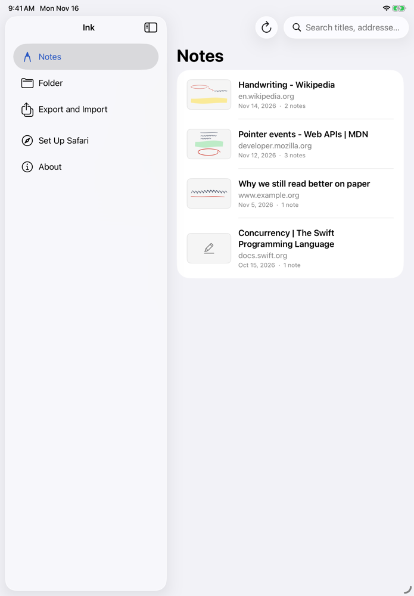

# PageInk for Mac and iPad

This folder holds the Xcode project for the PageInk app, which carries the Safari build of the extension.
The app is also where the notes library, export, import, the folder and the clouds live.



## Rebuild everything

From the repository root:

```
corepack pnpm apple            # extension, then macOS app and iOS Simulator app, signing off
corepack pnpm apple test       # unit tests on macOS and on an iPad simulator
corepack pnpm apple check      # check the built bundles and the names, without building
corepack pnpm apple mac-local  # macOS app signed to run locally (see "Run on the Mac")
corepack pnpm apple device-check  # the guided check on a real iPad with a Pencil, see (f)
```

When there is no iPad simulator, `test` makes a temporary one on the newest iOS runtime and
deletes it afterwards.

Every build ends with `check-bundle.sh`, which looks inside each built app. It fails when the
extension there is not the Safari build (no `nativeMessaging`, a Chrome or Firefox key, or
`use_dynamic_url`), when the page scripts are not the current layout (`stub.js`, and
`content/boot.js`, `loader.js` and `tools.js`, with `scripting` in the permissions and no viewer
inside the stub), when a file that the manifest, a page or a script names is missing, when
`LICENSE`, `NOTICE`, the PDF viewer page or its PDF.js files are missing, or when a file is left
from an earlier build. `test` and `check` also run `check-names.sh` (see "Change the name").

It also checks that the app and the extension can meet. Both must name one App Group. A signed
Mac pair must either claim that group, which must not be named exactly like the app, or carry the
same folder of the build signed to run locally (see (a)). A bundle signed with a team must not
carry that folder.

The check also looks for two things the App Store asks for. The app and the extension must carry
the privacy manifest, `Shared/PrivacyInfo.xcprivacy`. It says that nothing is collected or tracked,
and why the code reads its own settings and file dates. The app's `Info.plist` must also say that
the app has no encryption of its own (`ITSAppUsesNonExemptEncryption`, set in
`Config/PageInk.xcconfig`).

The command builds the extension with `corepack pnpm --filter pageink-extension build:safari` and then
runs `xcodebuild`. Products go to `apple/build`, which git ignores.

When you build in Xcode instead, build the extension first with the command above. A build phase
in both extension targets runs `sync-extension.sh`, which copies
`packages/extension/.output/safari-mv3` into the extension bundle. Chunk names change between
builds, so the script copies the whole folder and removes stale files. There is nothing to add
to the project by hand.

## Layout

| Path                                | Holds                                                                     |
| ----------------------------------- | ------------------------------------------------------------------------- |
| `Config/PageInk.xcconfig`           | The app name, the bundle id base, the App Group and signing. Rename here. |
| `Config/Local.xcconfig`             | Your team id and bundle id base. Not in git. Copy the `.example` file.    |
| `Config/Local-macOS.entitlements`   | Signing for `mac-local` only: one folder for the app and the extension.   |
| `Shared/`                           | File store, native protocol, mirror, records, zip, clouds and the lock.   |
| `Extension/`                        | `SafariWebExtensionHandler`, used by both platforms.                      |
| `App/`                              | The SwiftUI app, one codebase for Mac and iPad.                           |
| `Tests/`                            | Unit tests. They run on macOS and on the iOS Simulator.                   |
| `SimTests/`                         | UI tests that drive Settings, Safari and the app on an iPad simulator.    |
| `sim/`                              | The runner, test pages and page server for `SimTests`. See (d).           |
| `device/`                           | The guided check on a real iPad: runner, page and server. See (f).        |
| `sync-extension.sh`, `build.sh`     | Copy the extension in, and the build command above.                       |
| `check-bundle.sh`, `check-names.sh` | The bundle check and the name check that `build.sh` runs.                 |
| `media/`                            | The screenshot in this file.                                              |

The project uses folder groups: a new Swift file in one of these folders is part of its targets
without editing the project.

## How the extension gets into Safari's pages

Safari works like Chrome, Edge and Firefox (`docs/CONTRACT.md` section 4). Every page gets only
`stub.js`, about 3 KB: one storage read and a few listeners. On sites with ink the background
registers `content/loader.js` (the code that shows ink) to run at the start of the page. Elsewhere
the stub asks the background when it needs it, and the background injects the viewer and the
tools (`content/tools.js`) into that page: on the first Pencil touch, or when drawing is switched
on. Until the tools are in, the stub cancels the Pencil's touches, so the page does not scroll and
Scribble does not start, and it keeps the pointer events for the tools, so the first stroke after
a page load writes in full.

This needs Safari 17 or later, the same floor as the app (iOS and iPadOS 17, macOS 14). What
Safari supports, with versions and sources, is in `docs/CONTRACT.md` section 4.2. Safari keeps
PDF addresses in its own viewer; the extension's PDF viewer opens from **Open a PDF**.

## How notes are stored

The extension talks to the app through `browser.runtime.sendNativeMessage`, with the protocol in
`packages/extension/NATIVE_PROTOCOL.md`. The handler keeps notes in the App Group container, in
`Store/pages/<hash>.ink.json`. That container belongs to the app, so clearing Safari's website
data or removing only the extension does not remove notes. The Mac build signed to run locally
has a folder of its own in its place, see (a).

When you choose a folder in the app, the extension first tries to open it itself, through the
bookmark the app shares in the App Group. If that works, Safari writes straight to the folder.
If not, Safari keeps writing to the container, and the app copies changes both ways every time it
opens or comes to the front, and when you tap Sync Now. Per file, the side that changed wins.
When both sides changed, the newer copy keeps the name and the other is kept next to it as
`<name> (conflicted copy <date>).ink.json`. The extension merges such copies by record key.
The Folder screen says which of the two ways is in use.

Deleting a page in the app removes its notes the way the extension does: their ids are added to
`deleted`. Removing the file alone would not work, because Safari would write it back.

## Change the name or the bundle id

Edit `Config/PageInk.xcconfig`. `INK_DISPLAY_NAME` is the name on the Home Screen, in the Dock, in
Safari's extension list and in the app's own text. `INK_BUNDLE_ID_BASE` is the app's bundle id;
the extension adds `.extension` and the App Group is derived from it. The name inside Safari's
extension popup comes from the extension's manifest, which is built in `packages/extension`.

The plists, entitlements and project settings use `$(INK_DISPLAY_NAME)`, `$(INK_BUNDLE_ID_BASE)` and
`$(INK_APP_GROUP)`, and the Swift code reads the values from its bundle. `check-names.sh` fails if
the name, the bundle id base or an App Group id is written anywhere else in this folder, apart
from this file, `Local.xcconfig.example` and the file names `PageInk.xcconfig` and
`PageInk.xcodeproj`, which carry the current name. It also fails if a former name or bundle id base
is still written there, even in a file name; the list of former values is at the top of
`check-names.sh`.

## (a) Run on the Mac in Safari

With a team (free personal team is fine):

1. Open `apple/PageInk.xcodeproj` in Xcode.
2. Choose **Xcode > Settings > Accounts** and add your Apple Account if it is not there.
3. Copy `Config/Local.xcconfig.example` to `Config/Local.xcconfig`. Set `INK_BUNDLE_ID_BASE` to
   something of your own, such as `com.yourname.ink`. Set `DEVELOPMENT_TEAM` to your team id,
   or leave it empty and do step 4.
4. Click the project in the navigator, then for each of **App (macOS)** and **Extension (macOS)**
   open **Signing & Capabilities** and pick your team.
5. Run `corepack pnpm --filter pageink-extension build:safari` once.
6. In Xcode, choose the **App (macOS)** scheme and **My Mac**, then **Product > Run**.

Without a team, run `corepack pnpm apple mac-local` and open the app it prints. It is signed to
run locally. This build keeps notes in `~/Library/Application Support/<bundle id base>.local`,
not in an App Group container. Delete that folder to remove them.

The reason: with no team, macOS does not let the app and the extension share an App Group
container. The group is then named exactly like the app, and macOS gives the app its own
container for it (`~/Library/Containers/<bundle id>/Data`) and the extension another folder
(`~/Library/Group Containers/<bundle id>`), so the Notes list stays empty. A group with any other
name does not work either: on macOS 26 the app then stops at its first access to the group
folder and waits, because macOS guards the group folders of apps it cannot tie to a team. So
`mac-local` signs the app and the extension with `Config/Local-macOS.entitlements`, which lets
both into that one folder, and `Shared/SharedSpace.swift` reads the folder from the signature.
A Mac app signed to run locally in any other way, such as from Xcode with no team, says
"Storage is not available", and notes stay in Safari's own storage.

Then in Safari:

1. Choose **Safari > Settings > Advanced** and turn on **Show features for web developers**.
2. Choose **Safari > Settings > Developer** and turn on **Allow unsigned extensions**. On older
   Safari it is **Develop > Allow Unsigned Extensions**. Safari turns this off when it quits, so do
   it again after each restart.
3. Choose **Safari > Settings > Extensions**, turn on **PageInk**, click **Edit Websites** and set
   **When visiting other websites** to **Allow**.
4. The app's **Set Up Safari** screen shows whether the extension is on, live.

To see whether Safari knows the extension, run `pluginkit -m -p com.apple.Safari.web-extension`.
It lists the extension's bundle id once the app has been opened. Safari's WebDriver cannot turn
on an unsigned extension, so the checks below are done by hand.

What to check on the Mac:

- [ ] A Wikipedia article: click the toolbar button, then **Draw on this page**, and write with the mouse or
      a pen tablet. Reload: the ink comes back on the same words.
- [ ] **Option+Shift+D** turns drawing on and off on the page. If it does nothing, look in
      **Safari > Settings > Extensions > PageInk** for the shortcut, or set one there.
- [ ] Write a note next to a paragraph, then remove that paragraph in the Web Inspector and
      reload. The tray button on the bar shows a count. Open the tray: the note is listed with
      its words. **Place** puts it back where you click.
- [ ] Click the toolbar button, then **Settings**, then **Open a PDF**. Click **Open file** and pick a PDF.
      Its pages show and take ink. Open the same file again: the ink comes back.
- [ ] Open the app's **Notes**: the pages appear with a small drawing of the ink.
- [ ] Safari's **Develop** menu has no errors from the extension's background page
      (**Develop > Web Extension Background Content > PageInk**).

The PDF viewer uses the legacy build of PDF.js 6, which carries its own polyfills, so PDFs open
on every Safari the app supports (17 and later, on iOS, iPadOS and macOS). If a browser still
cannot run it, the PDF page says so and Safari's own viewer keeps the file.

## (b) Install on an iPad over a cable with free signing

1. On the iPad: **Settings > Privacy & Security > Developer Mode**, turn it on, and restart when
   asked. The switch appears after the iPad has been connected to Xcode once.
2. Connect the iPad to the Mac with a cable. Tap **Trust** on the iPad if it asks.
3. In Xcode: **Xcode > Settings > Accounts**, add your Apple Account. A free account makes a
   personal team.
4. Set your own bundle id base, as in (a) step 3. Bundle ids are unique across all accounts.
5. Click the project, then for **App (iOS)** and **Extension (iOS)** open **Signing &
   Capabilities**, keep **Automatically manage signing** on, and pick your personal team. Xcode
   registers the bundle ids and the App Group.
6. Run `corepack pnpm --filter pageink-extension build:safari` once.
7. Choose the **App (iOS)** scheme and your iPad as the destination, then **Product > Run**.
8. The first launch is refused. On the iPad open **Settings > General > VPN & Device Management**,
   tap your Apple Account under **Developer App**, and tap **Trust**. Run again from Xcode.
9. Turn the extension on: **Settings > Apps > Safari > Extensions > PageInk**, turn on
   **Allow Extension**, then under **Permissions** set **All Websites** to **Allow**.
   Or in Safari, open the page menu in the address bar, tap **Manage Extensions**, turn on PageInk,
   then open the page menu again, tap **PageInk** and choose **Always Allow on Every Website**.

Apps signed with a free team stop opening after seven days. Run from Xcode again to renew.

## (c) What to check on the iPad

Use three unrelated sites, for example a Wikipedia article, a news article and a docs page.

- [ ] Apple Pencil writes on each page. A finger scrolls and taps links as usual.
- [ ] The first Pencil stroke after a page load writes instead of scrolling the page.
- [ ] Reload the page: the ink comes back in the same place.
- [ ] Rotate the iPad: the notes stay on the words they were written on.
- [ ] Scribble does not turn strokes into text and does not grab the Pencil. If it does, check
      **Settings > Apple Pencil > Scribble** and report what you saw.
- [ ] Clear website data (**Settings > Apps > Safari > Clear History and Website Data**), reload:
      the ink is still there.
- [ ] Open the app: the pages appear in **Notes** with a small drawing of the ink.
- [ ] Tap the extension's button in Safari, then **Settings**, then **Open a PDF**, tap
      **Open file** and pick a PDF from Files. The Pencil writes on its pages.
- [ ] Without a keyboard there is no shortcut. **Draw on this page** in the extension's menu turns drawing on and off.
- [ ] Delete a page in the app, reload it in Safari: its notes are gone.

## (d) Checks a machine runs on an iPad simulator

```
corepack pnpm apple sim-test
```

This runs the extension in real Mobile Safari on a new iPad simulator and prints a pass or
fail line per check, with what each check saw. It needs Xcode and an iOS simulator runtime.
It takes about ten minutes. Logs, result bundles with screenshots and `summary.txt` go to
`apple/build/sim`. The workflow **iPad simulator** in `.github/workflows/simulator.yml` runs
the same command when started by hand.

What the command does, in `sim/run.sh`:

1. Builds the Safari extension, then the app and the `SimTests` UI tests for the simulator.
   The build is signed to run locally (no team, no account), so the simulator honours the App
   Group and the app can read what the extension's native handler writes.
2. Makes an iPad simulator on the newest iOS runtime, boots it, installs the app and opens it
   once, which registers the extension with Safari.
3. Serves `sim/pages` and the extension's e2e pages from this Mac with `sim/serve.ts`. The
   simulator shares the Mac's network, so Safari opens them at `127.0.0.1`. `/paper.pdf` is a
   small text PDF made by the e2e helper.
4. Runs the UI tests in phases: `A_SetupTests`, `B_SafariTests`, `G_ConnectTests` (the Sync
   screen shows the three choices, and "Not set up in this build." without client ids), then it
   shuts the simulator down, boots it again and runs `C_AfterRebootTests`, then `H_TimingTests`
   and `E_SiteAccessTests`. Then it deletes the simulator.

It builds the bench variant of the extension (`wxt build --mode bench`): the release code plus
the performance marks the test pages read to see that the stub ran. `INK_SIM_KEEP=1` keeps the
simulator, `INK_SIM_ID=<udid>` uses one you made, and `INK_SIM_ONLY=B`, `C`, `E`, `G` or `H` runs
setup and one phase. `INK_SIM_DIAG=1` instead builds the diagnostics variant that the device check uses,
with the test server as its one origin, and runs `F_DiagnosticsTests`: the check page channel and
the website check in Mobile Safari. Strokes in the PDF viewer still need an iPad and a Pencil.

### How the extension is turned on by automation

On iOS 26 the state lives in Safari's container, in
`Library/Safari/WebExtensions/Extensions.plist`, keyed by `<extension bundle id> (UNSIGNED)`:
`Enabled` is true and `GrantedPermissionOrigins` holds `*://*/*` once all websites are
allowed. Editing that file works only with Safari closed and is not a public interface, so
the setup test does what a reader does instead. It opens the Settings app and goes to
**Apps > Safari > Extensions > PageInk**, turns on **Allow Extension**, and sets **All Websites**
to **Allow**. The rows are found by their accessibility identifiers: `com.apple.settings.apps`,
`com.apple.mobilesafari`, the extension's bundle id, the `Allow Extension` switch, and the
cell named `1` (Allow) on the All Websites screen. It also turns off **Hide Tab Bar While
Scrolling**, so the extension's toolbar button stays visible after a page scrolls.

The extension's popup is reached the same way a reader reaches it: the extension's button
in the address bar. Its web view is in Safari's accessibility tree, so **Draw on this page**
is a switch the test taps. Nothing test-only is in the product.

### What the tests check

The test pages print one line of what the page itself can see (`sim/pages/report.js`):
whether an `<ink-layer>` host exists, whether the stub left its `ink:stub` measure, the
scroll position, and where the marker words are. The test reads that line from the
accessibility tree and maps the words to screen points. Ink is found in screenshots: the
pages set their text in grey, so dark blue pixels on the words are the first pen colour.

- The first start of Safari with the extension on opens the guide once, as a tab behind the page
  in front. After Safari was quit and opened again and every tab was closed, it does not come back.
- The stub runs in Mobile Safari and adds nothing to a page without ink.
- With draw mode on, one finger writes on the words, and the ink shows.
- The bar's buttons are at least 44 points and do not cover the page's link, button or field.
- Scrolled to its end, the page's last line is clear of the bar at the bottom edge.
- A note whose words are gone shows a count on the bar, and the tray opens with it.
- Two fingers scroll in draw mode and make no ink.
- With draw mode off a finger scrolls, makes no ink, and a link works.
- Reload, landscape and back, quitting Safari, and rebooting the simulator: the ink is on the
  same words each time.
- An open accordion section and an inner scroller: the tests write there, close and open the
  section, scroll the box, and report what the ink did.
- A PDF address opens in the extension's PDF viewer and its text shows.
- **Clear History and Website Data** (All history) clears the site's data, and the ink stays,
  because notes live in the extension's storage and the app's container. The page shows that
  its cookie is gone. In the simulator its localStorage for `127.0.0.1` stays, and the site is
  not listed under **Advanced > Website Data**, so the test clears all sites.
- The app's Notes list shows the page written in Safari, and Share Archive opens the share
  sheet.
- With **All Websites** on **Ask**, the popup shows one line that says what to tap, and the app's
  setup screen says the step is not done. With **Allow**, there is no line and the setup screen
  says every website is allowed. The test then sets **Allow** again.
- Whether the registered viewer ran at the start of the page (the bench mark `ink:boot`), after
  a reload, after Safari was quit and after the simulator rebooted.
- Timings (phase H), each the median of several loads, in ms from the page's first byte: when the
  stub starts and how long its own work takes on a site without ink (the server under the name
  `localhost`), how long the background takes to inject the viewer and the tools when drawing is
  switched on there, and when the first ink shows on a page with ink.

Two fingers moving together are not in XCTest's public API. `SimTests/Synth.m` makes them with
XCTest's own event classes (`XCSynthesizedEventRecord`, `XCPointerEventPath`).

### What still needs an iPad and an Apple Pencil

XCTest in Xcode 26 synthesizes touch, mouse, key, text and pressure events only: the event
path classes have no stylus kind, azimuth or altitude. Replaying a recorded HID event stream
is refused on the simulator ("Remote interface does not support HID event recording"). The
Simulator app and `simctl io` have no Pencil input either. So every touch in these tests is a
finger with draw mode on. The stylus code path is covered as far as a machine can by
`packages/extension/src/content/stylus.browser.test.ts`, which sends pen pointer events and
stylus touches through the real stub and capture in WebKit.

Only these still need an iPad with an Apple Pencil, from the list in (c). The guided check
in (f) covers all but the last:

- The Pencil writes without draw mode, and the first stroke after a page load writes instead
  of scrolling (real `touchType: "stylus"` touches in iPad Safari).
- Scribble does not turn strokes into text.
- A palm on the screen while the Pencil writes is ignored.
- Picking a PDF from Files in the viewer's file picker (the tests open a PDF by its address).
- Delete a page in the app, then reload it in Safari.

## (e) Choose a folder and see the files

1. In the app, open **Sync** and tap **A folder on this device**.
2. Pick or create a folder, for example **iCloud Drive > PageInk Notes**, and tap **Open**.
3. The app copies notes there right away. **Last sync** shows when, and the footer says whether
   Safari writes to the folder directly or through the app.
4. Tap **Show Folder** to open it in Files or Finder. Each page is
   `pages/<hash>.ink.json`, plain JSON that any text editor can open.
5. On another device, choose the same folder. Notes from both meet there.
6. **Disconnect** keeps every note on the device and leaves the files where they are.

Export and import work without a folder: **Export and Import** shares or saves a zip with the
same `pages/` layout, or all notes as Markdown, and imports a zip back.

## (f) The guided check on a real iPad

The checks in (d) cannot hold a Pencil. This one asks a person to, and keeps the evidence.

```
corepack pnpm apple device-check     # build, install, open the check page on the iPad, wait
corepack pnpm apple device-remove    # take the app off the iPad again
```

Before the first run:

1. Copy `Config/Local.xcconfig.example` to `Config/Local.xcconfig` and fill in your team id and
   a bundle id base of your own, as in (b).
2. Xcode needs your Apple Account (**Xcode > Settings > Accounts**), so it can make a signing
   profile for the iPad. A paid team works as is. A free personal team works too, with the
   limits in (b). If the team cannot have the App Group, the command signs without it: the
   check works the same, and only the app's Notes list stays empty.
3. Connect the iPad with a cable once and switch on Developer Mode, as in (b) step 1.
4. The Mac and the iPad must be on the same Wi-Fi.

What the command does, in `device/run.sh`:

1. Finds the paired iPad. It stops with plain words when Developer Mode is off, when Xcode
   has no account, or when this Xcode is too old for the iPad's system.
2. Builds the extension with diagnostics (below), then builds, signs and installs the app.
3. Serves the check page from this Mac (`device/serve.ts`) and opens it in Safari on the
   iPad. If that cannot be done from the Mac, it prints the address in big digits and as a QR
   code for the iPad's camera.
4. Waits while the person follows the page, then prints a summary and exits with 1 when a
   check failed or was not done. `results.json`, `summary.txt`, the logs and screenshots go to
   `apple/build/device/<date and time>`.

The page shows one step per screen in large type, with a Next button and a progress line:
switch the extension on (Settings, Apps, Safari, Extensions, the app, Allow Extension, All
Websites: Allow), write hello with the Pencil, scroll with a finger, write with a hand resting
on the screen, tap a text box and write next to it, reload, turn the iPad, and open
`test.pdf` from Files in the PDF viewer and write on it.

The page decides by itself where it can: whether the strokes came from the Pencil, with
draw mode off, including the first one after the page loaded; whether the page scrolled or
selected text while the Pencil wrote; whether a finger scrolled without making ink; whether
a hand made ink; whether Scribble typed into the box; whether the ink layer came back. Where
only eyes can tell, it asks one yes or no question, such as "Did your writing appear as ink?".

Each step ends with one of these outcomes in the summary:

- `PASS`: it worked.
- `FAIL`: it did not work, or the person said No.
- `SKIP`: the step could not be done, such as a turn with rotation lock on.
- `SEEN`: the person saw it work, but the check got no record of it. Only the PDF step has it:
  the person said Yes and no stroke record came from the viewer. It is not a failure, and the
  exit code does not count it.

For the PDF step the check page sends the person to the viewer with `?from=check`. In a
diagnostics build the viewer then shows a **Back to the Pencil check** button, which goes back
to the PDF step. The page keeps what it needs in the site's storage, not the tab's, so it finds
the viewer's strokes in whatever tab the person comes back.

### Diagnostics, and why they never ship

`INK_DIAG_ORIGIN=http://<this Mac>:<port>` makes a diagnostics build of the Safari extension
in `packages/extension/.output/diag`, apart from the shipped builds. For each stroke, capture
reports the pointer type, the pressure range, the samples and their rate, coalesced and
predicted samples, stylus touches and how many were cancelled, finger touches while the
Pencil was down, whether the stub held the first stroke and handed it over, how many events it
held, the time from pen-down until the tools took them and how much of that was spent waiting for
the background to inject the viewer and the tools, the scroll before and after, and the time from
pen-down to the first painted frame. The records stay in the
extension's storage and reach the check page by `postMessage` aimed at that one origin. They
hold counts and times, never page content. The page adds what it saw itself and sends it to
the Mac.

The switch cannot reach a release. It works only for Safari and only for a plain http address
on the local network. `INK_RELEASE=1` refuses it, store zips refuse it, and the Release build
of the app refuses an extension that carries it (`sync-extension.sh`). Every other build
compiles the code out, and `packages/extension/test/diag.test.ts` checks all of this.

### Screenshots

When the UI test runner can be signed for the iPad, `SimTests/D_DeviceShots` opens the
check page and takes a screenshot each time the step changes. It never taps or changes a
setting. Without it the check runs the same, with no screenshots. `INK_DEVICE_SHOTS=0`
turns them off.

## Privacy

The app and the extension talk to nobody until you connect Google Drive or OneDrive under
**Sync**. Then they talk only to that provider's sign-in and file hosts (PRIVACY.md lists them).
There is no account with us and no analytics. Opening a test page or one of your pages hands the
address to Safari; the app itself loads nothing else.

How it is kept that way:

- One type, `PinnedNet` in `Shared/CloudNet.swift`, makes every request. It refuses any address
  that is not https on a pinned host, before sending, and follows a redirect only to a pinned
  host, without the token. No cookies, no cache.
- `Tests/NetworkRuleTests.swift` scans every Swift file in `App/`, `Shared/` and `Extension/` and
  fails on any other network call, and checks that no plist loosens App Transport Security.
- `testNoRequestBeforeConnect` in `Tests/CloudHandlerTests.swift` runs every request the
  extension makes without a cloud and checks that nothing was sent.
- On the Mac the sandbox has `network.client` (outgoing only), which a sandboxed app needs to
  reach a cloud at all. The iPad needs nothing for it.

## (g) Google Drive and OneDrive

Under **Sync** the app offers the same three choices as the extension: Google Drive, OneDrive,
and a folder on this device (iCloud Drive works). A cloud needs client ids in
`Shared/cloud-ids.local.json` (git ignores it); without them the choice says "Not set up in this
build." [docs/CLOUD_SETUP.md](../docs/CLOUD_SETUP.md), "The Apple app", has the steps.

How it works:

- **Sign-in.** The app opens the provider's own page in the system sign-in window
  (`ASWebAuthenticationSession`): the code flow with PKCE, no client secret, and no library.
  Google uses an "iOS" client from the same Google Cloud project as the extension, for the iPad
  and the Mac; Microsoft uses the extension's registration with `msauth.<bundle id>://auth`.
  Tokens go to the keychain, in the App Group's access group, so the extension's handler can
  use them. Disconnect removes them and gives Google's back.
- **From Safari.** The extension's Google Drive and OneDrive buttons ask the handler. When the
  app has no sign-in for that cloud yet, the handler notes the request and answers `pending`.
  On the Mac it opens the app; on the iPad the extension shows **Open PageInk**, and Safari asks
  to open the app. The app starts the sign-in as soon as it opens.
- **What runs where.** The handler talks to the cloud itself for Safari's `list`, `read`,
  `write` and `remove`, so Safari syncs with no app open. Every write goes to the container
  first, so this device always has every note. A write the cloud cannot take now waits in a queue
  in the container (`Queue/`, listed in `State/queue.json`). The handler sends what waits before
  it lists, for up to five seconds; the app sends all of it when it opens or comes to the front,
  and iPadOS may wake it for a background refresh (`BGAppRefreshTask`, no entitlement needed,
  and no promise of when). A Mac app is not woken; there the handler and the next open do it.
  A waiting change whose file changed elsewhere goes up as a sync copy, never over it.
- **The library.** The app copies new files from the cloud into the container, so Notes shows
  pages from every device. Export and import work the same with every place; imported and
  deleted pages go up to the cloud through the queue.
- **The lock.** The switch under **Sync** works as the extension's: it asks for a password
  twice, warns that a lost password cannot be recovered, seals each file on the device, and
  offers a recovery key to print or save. A device that was given the password keeps the key in
  the keychain. Turning the lock on or off resumes on the next sync if it stopped halfway. A
  file the key does not open is left alone.
- **Code.** `Shared/CloudNet.swift` (network), `CloudAuth.swift` (sign-in and tokens),
  `CloudProviders.swift` (Drive and Graph, as `packages/extension/src/cloud/`),
  `CloudFolder.swift` (names to ids), `Places.swift` (place, queue, handler routes, app sync),
  `Lock.swift`, `Secrets.swift` (keychain), `App/SyncView.swift` and `App/SignInWindow.swift`.
